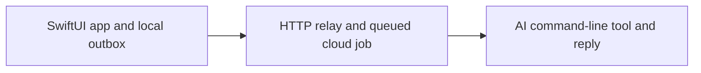

# AppDesk

## Architecture

An iPhone client under development for sending requests about individual apps to a subscription-backed AI assistant.

### Follow one interaction

Choose an app and send a request. The phone records it locally and sends it to a private relay. A cloud worker can pick up the job, use the AI CLI and return a reply for that app.

## APIs and interfaces

| Connection | What crosses it |
| --- | --- |
| SwiftUI → private HTTP relay | GET /v1/apps lists managed apps. POST /v1/apps/{app}/messages sends a request; GET on the same route reads the thread. |
| Cloud job → AI CLI | The worker calls a subscription-authenticated command-line tool. The phone talks to the relay rather than storing the CLI session. |

### Why it works this way

The app ID and request ID travel with the message. They keep conversations separate and let the client recognise a repeated delivery. Cloud source checks have been tested; the full phone-to-release workflow is still in development.

## Read the implementation

See [AppDeskProtocol.swift](AppDeskProtocol.swift) for how a message identifies its app, request and checks. This source module is an excerpt from the application.

[Back to the project index](https://github.com/IT-Yun/IT-Yun)
